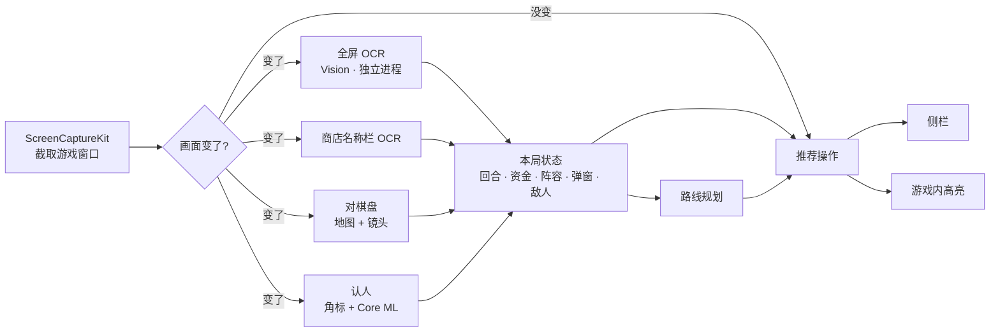

# 卫戍协议小助手 for Mac

作者在《明日方舟》卫戍协议里打了 40 局，只过了 3 局。想找个小助手帮忙，搜了一圈才发现现有的几个（StrongholdAssistant、ASP_Assistant、鸿雪·卫戍助手）都只有 Windows 版，于是参考这三个项目，把它们的功能移植到了 Mac 上，并按 Mac 客户端的画面重新调了识别。

开着它打一局，它看着游戏画面，告诉你**这回合买谁、升不升本、谁站哪**，并直接在游戏画面上框出来。

- **只读屏幕**：不点击、不改游戏。
- **尽量用硬件加速**：文字识别用系统自带的 Apple Vision；场上认人用 Core ML 跑在 Apple 芯片的神经网络引擎上（11 个单位约 5 毫秒）；画面没变就不重新识别。全部在本机运行，不需要独立显卡，也不联网（可选的 AI 教练除外）。
- **之后会另开一个 MaaFramework 分支**：用上游项目同款的识别框架做一版，和现在的 Vision + Core ML 对比。

当前版本见 [`VERSION`](VERSION)，更新记录见 [CHANGELOG.md](CHANGELOG.md)。

## 目录

- [下载](#下载)
- [从源码构建](#从源码构建)
- [能做什么](#能做什么)
- [工作原理](#工作原理)
- [已知限制](#已知限制)
- [路线图](#路线图)
- [开发](#开发)
- [作者](#作者)
- [致谢与许可](#致谢与许可)

## 下载

到 GitHub 的 [Releases](../../releases) 页下载 `GarrisonHelperMac-vX.Y.Z-macOS.zip`，解压后把「卫戍协议小助手」拖进「应用程序」。应用没有 Apple 开发者签名，第一次打开会提示无法验证开发者：到 系统设置 → 隐私与安全性，点「仍要打开」。每个版本都由 GitHub Actions 从对应的源码编译，附 SHA-256 校验（仓库公开后还会附构建来源证明）。

## 从源码构建

需要 macOS 14+、Xcode Command Line Tools（`xcode-select --install`）。

```bash
./scripts/build-app.sh
```

```bash
open "dist/卫戍协议小助手.app"
```

1. **授权**：系统设置 → 隐私与安全性 → 屏幕与系统录音，勾选「卫戍协议小助手」，重新打开应用。小助手自己不会弹权限申请；没权限时侧栏有「打开设置」和「重新打开」两个按钮。每次重新构建后要再勾一次（不想勾可以建本地签名证书，见 [docs/开发.md](docs/开发.md#签名屏幕录制权限不用每次重新勾)）。
2. **选窗口**：顶部选「明日方舟」的窗口，打开「实时」。
3. **开打**：停在「确认本局信息」页时它会自动录入禁用盟约、敌方领袖和特训敌人；之后照着「推荐操作」和游戏画面上的框走就行。

## 能做什么

| 时机 | 小助手做什么 |
| --- | --- |
| 开局 | 自动读禁用盟约、敌方领袖、特训敌人、自选编队；按模式、策略和敌情推荐**能玩的路线**（每个本家、以及「两个小盟约Ⅱ + 本家Ⅰ」），开局 → 成型分五个阶段，每个终端等级写明买谁、留谁、何时升本 |
| 商店 | 在游戏画面上给该买的牌编号、框出升本 / 刷新 / 冻结；替身卡（Pith、郁金香…）认出真身；**下回合资金**预测（剩的钱留不到下回合，升本价每回合降 1）；三合一后的免费牌推荐拿哪张；**特别关注**的干员一出现就提醒 |
| 休整期 | 认出场上和整备区的每个人（阶级角标 + 小人模型），自动同步阵容；给出上场 / 下场 / 出售，以及**每人站哪格、朝哪边**（按本回合真实的敌人路线、红地板 / 蓝箭头 / 沼泽等特殊格）；侧栏有战场小地图 |
| 弹窗 | 悬赏决策（按你的阵容强度估「稳拿 / 能打 / 很难打」和期望资金）、道具补给 / 机密商店、战术决策、自选编队：框出推荐的那张 |
| 对手 | 读玩家列表和联防画面里别人在做的本家，别人也在做的路线打折（牌会被抢） |
| 敌人 | 每回合的地面 / 飞行路线画在游戏画面上；点开游戏里的敌人列表会读出名单并按名单筛路线；飞行多而远程少时提醒 |
| 出局后 | 一直在观战别人时自动暂停计算，新的一局自动继续 |
| 随时 | **AI 教练**一键「这回合怎么做」（DeepSeek / 通义千问 / Claude / 任意 OpenAI 兼容接口）；**战绩**统计（平均名次、前四率、各盟约表现）；**⌃⌥H** 隐藏 / 显示；干员、装备、盟约、策略、敌人图鉴 |

每一项的细节和规则见 [docs/功能说明.md](docs/功能说明.md)。

## 工作原理



一次完整读取约 0.1–0.25 秒（M4，release 版）：四路并行，耗时主要在全屏 OCR（约 0.13 秒）；认人 11 个单位约 5 毫秒；画面没变就不读。详见 [docs/开发.md](docs/开发.md#速度)。

## 已知限制

- **站位是规则打分**，不是战斗模拟：按本回合路线挡人、罩飞行航线，但不算伤害和漏怪数。关卡里列的是这回合所有可能怪组的路线（游戏每局随机出一组），点开敌人列表后才按名单筛；**每组来多少敌人不知道**（关卡文件里的人数只是模板，光第 2 回合的怪组就从 2 个到 10 个不等），所以不显示人数。m07、m08 两张图没有地图数据。
- **磁盘快满时**（剩余不到约 30 GB）macOS 会清掉神经网络引擎的模型缓存，文字识别会出错；小助手会自动重启识别进程并提示。
- 悬赏决策、道具补给、机密商店已在 Mac 客户端上验证；战术决策只按 PC 版布局实现，还没验证。
- 数据为规程 V3_1 赛季。

完整列表见 [docs/功能说明.md](docs/功能说明.md#已知限制)。

## 路线图

**下一步**
- 自动认出本局策略（现在要手选，选错会影响资金预测和路线）。
- 盟约状态列出每个盟约里有谁、没激活的还差几个人。
- 认不准的干员把「?」直接画到游戏画面的小人头上，点一下就能改。

**之后**
- 小棋盘上拖人试摆、固定位置后重排；直接认出被禁干员的头像。
- 用「战绩」里攒下的名次校正路线评分；有了商店刷新概率数据后，算「几回合能凑齐」。
- **MaaFramework 分支**：用 MaaFramework 做识别的一版，和现在的 Vision + Core ML 比准确率和速度；以后要做「帮你点」一类的功能也从这里开始。

**更远**
- 战斗模拟站位（算伤害和漏怪数）。需要授权清楚的怪组数据，目前还没有。

**不打算做**
- 阵容广场、云同步：需要自己架服务器。
- 模拟器 / ADB：Mac 版直接读 Mac 客户端，用不上。

## 开发

[docs/开发.md](docs/开发.md)：目录结构、离线调试命令、调试模式、回归检查（`scripts/regress.sh`）、版本号与发布、签名、git 约定、更新游戏数据。

参考项目源码放在 `../卫戍协议小助手-参考项目/`（仓库外，和小助手文件夹并列，不入库），每个移植功能对应的上游文件记录在 [REFERENCES.md](REFERENCES.md)。

## 作者

6622

## 致谢与许可

- [LBEILC/StrongholdAssistant](https://github.com/LBEILC/StrongholdAssistant)：干员 / 装备 / 盟约 / 策略 / 首领数据，场上认人（角标、小人模型），地图与敌人路线
- [Moonfair/ASP_Assistant](https://github.com/Moonfair/ASP_Assistant)：商店名称栏识别、准备页盟约禁用判断、图标
- [bingyunhe/hongxue-stronghold-companion](https://github.com/bingyunhe/hongxue-stronghold-companion)：阵容规划器、自动推荐路线、购买识别规则

三者都以 Apache-2.0 发布，上游的许可与 NOTICE 原文在 `licenses/`，派生关系见 [`NOTICE`](NOTICE)。本项目的**代码**以 Apache-2.0 发布（[`LICENSE`](LICENSE)）。

游戏美术、数据、角色名称归上海鹰角网络所有，**不在** Apache-2.0 许可范围内；用到了哪些、从哪来，见 [ASSETS.md](ASSETS.md)。本项目与鹰角网络无关，权利方要求时会移除相关内容。
